# Wasteland Archive · 废土馆藏

<p align="center">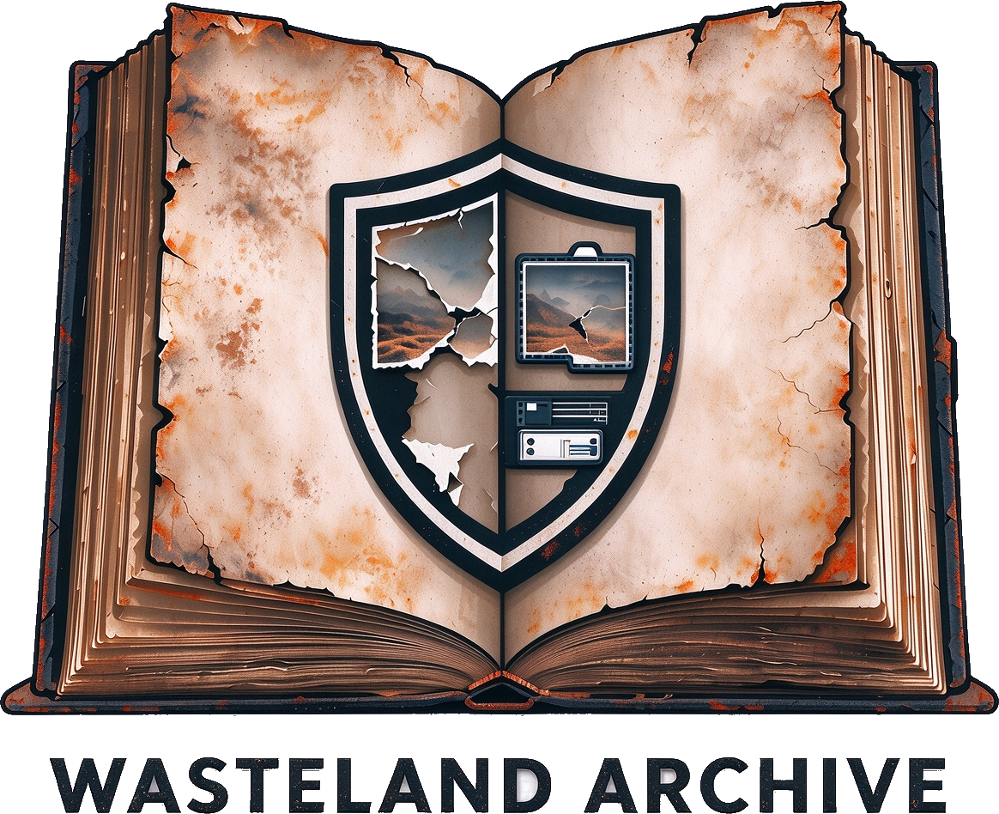</p>

**Version 1.1.7** · [Changelog](CHANGELOG.md)

**Wasteland Archive** is an offline-first, local reading terminal for magazines, PDFs, image folders and local media. The shell only opens the door: every collection is a plugin, and every plugin owns its own data.

English | [简体中文](langs/README.zh-CN.md)

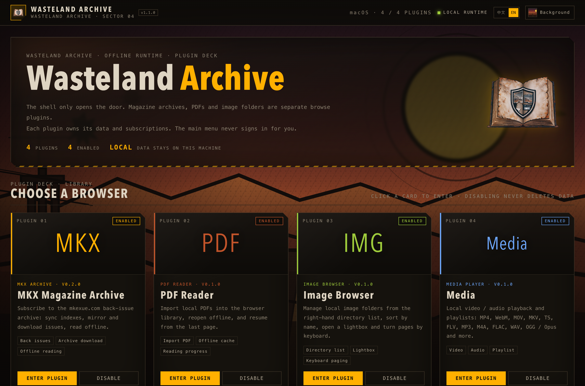

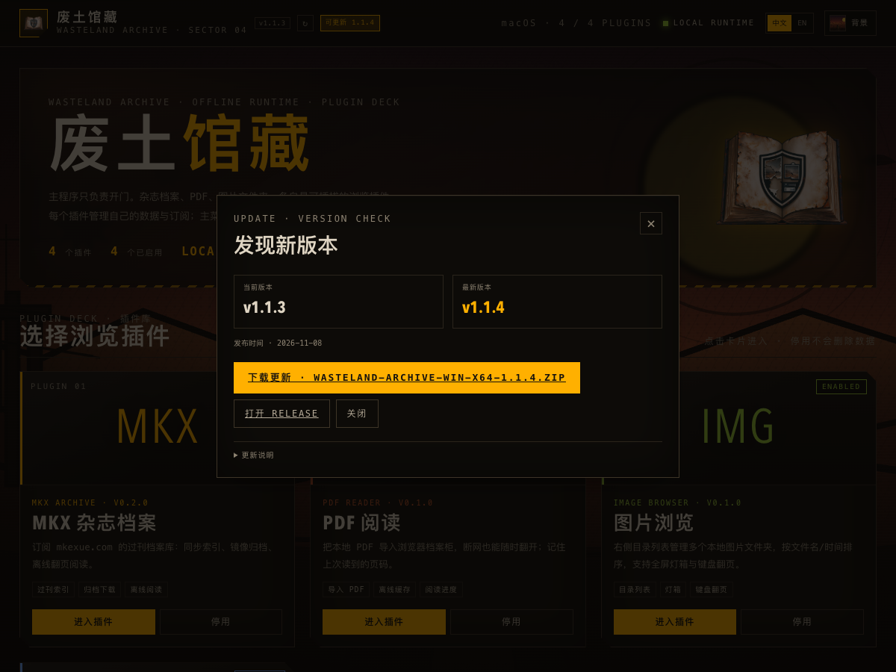

## Highlights

- **Offline-first.** Archives, PDFs, image folders and media live on this machine. Nothing is uploaded to a third-party cloud.
- **Plugin deck.** Four independent plugins: MKX magazine archive, PDF reader, image browser and media player. Disabling a plugin never deletes its data.
- **Native desktop apps.** Double-clickable Electron apps for macOS (Apple Silicon + Intel) and Windows x64. No terminal, Node or separate server is required after installation.
- **Update checks.** On startup the app checks GitHub Releases in the background (cached for 6 hours); an update badge opens a download dialog, and ↻ next to the version forces a check.
- **On-demand media transcode.** Unsupported videos use an in-memory HLS session; ffmpeg runs only for the segments the player requests. Pausing stops further work, and stopping/closing releases the segments.
- **Wasteland screens.** Original cel-shaded / ink-outline backgrounds ship with the app. Users can upload their own backgrounds to `~/.wasteland_browser/bg_screens`.
- **Bilingual UI.** Switch between English and 简体中文 from the top bar. Language packs live in `src/i18n/locales`.

## Plugins

| Plugin | What it does | Storage |
| --- | --- | --- |
| **MKX Magazine Archive** | Sync the mkexue.com back-issue index, mirror issues, download and read offline with page turning, zoom, pan, spread and filmstrip modes. | Server `data/issues` + browser IndexedDB for reading progress |
| **PDF Reader** | Import local PDFs, reopen offline, remember the last page, continue or start over. | Browser IndexedDB `wasteland-browser/pdfs` |
| **Image Browser** | Manage multiple local image folders, sort by name/time, lightbox and keyboard paging. | IndexedDB directory handles / session folders |
| **Media** | Local video/audio playback, folder trees, playlists, shuffle/loop modes, audio visualizers, SRT/VTT subtitles, resumable playback positions and on-demand HLS transcoding. Source files stay in place; the library index is server-side and transcode segments stay in memory. | Server media index in `~/.wasteland_archive` / Application Support |

### MKX archive

Log in inside the MKX plugin only. The main menu never signs in for you. Passwords stay in the browser; the server only caches a token in `data/auth.json` (mode 0600).

Downloads are deliberately **serialized**: only one archive job runs at a time, and each job fetches one page at a time. Additional issues stay queued until the previous job finishes. The **↻** button beside Sync re-reads the local `data/issues` directory — useful after copying archives in from another machine.

### PDF reader

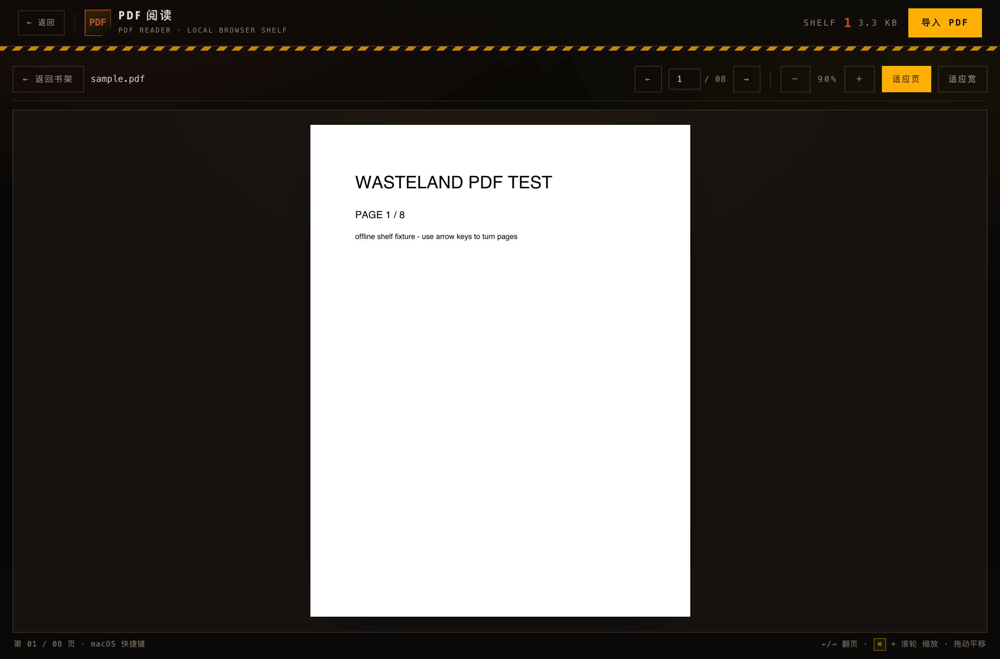

Sample: [sample10.pdf](https://samplelib.com/pdf/sample10.pdf) from samplelib.com.

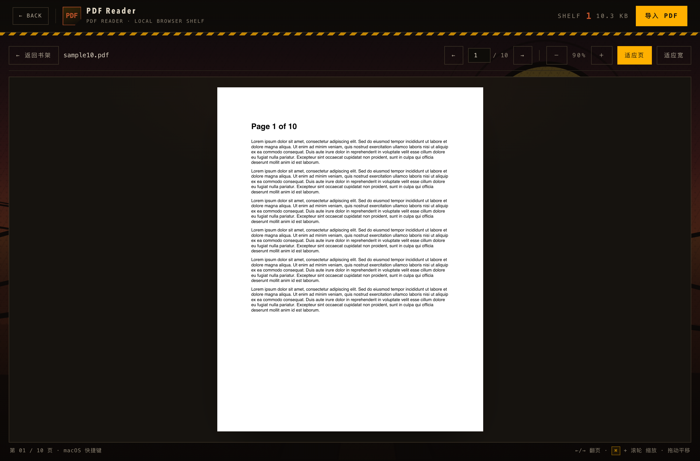

### Image browser

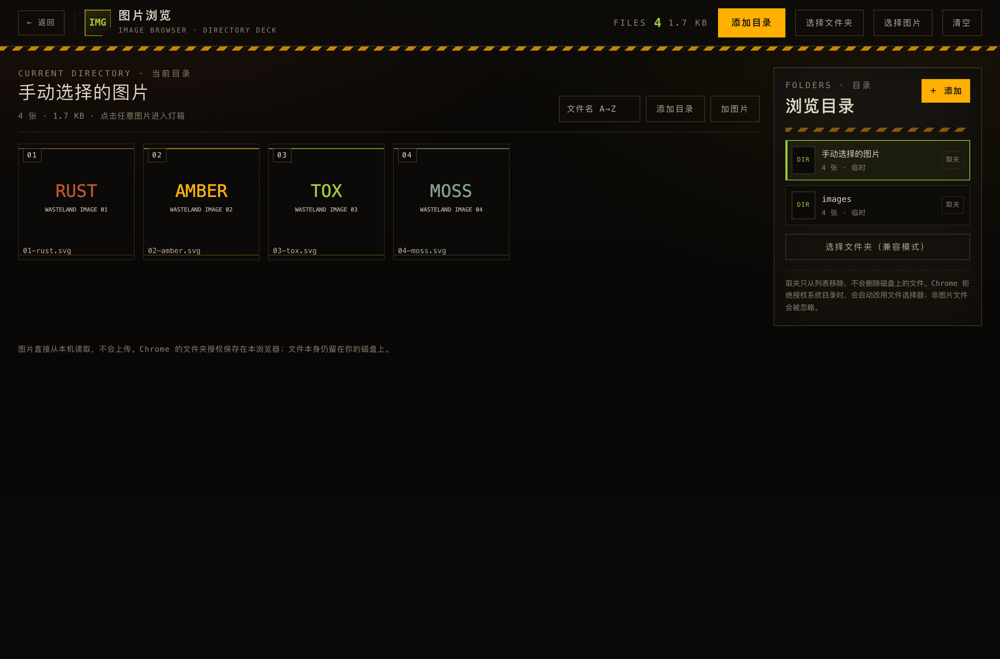

### Media

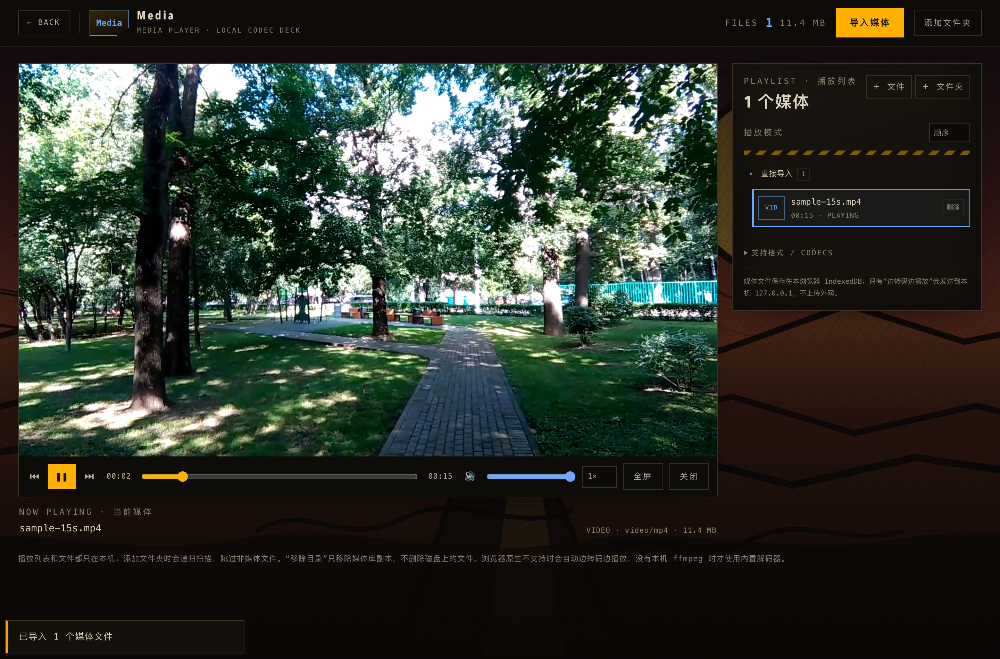

- **Play history.** The last eight played items are listed with progress; click one to continue from its saved position. A finished item starts from the beginning. The × button removes it from history without deleting the file.
- **Resume per file.** Switching tracks, leaving the plugin or restarting the app restores the last playback position; a finished file starts from the beginning.
- **File info.** INFO shows type, size and path with a copy button; set a folder root or file path once for the browser’s privacy-restricted paths.
- **Subtitles.** Folder videos auto-load a same-name `.srt` / `.vtt`; load one manually at any time, toggle with CC, and the overlay works in fullscreen.
- **Server-backed library.** Add an absolute directory path once — paste it or choose it from the native folder dialog; the server scans it and keeps the index, positions and subtitles in `~/.wasteland_archive` (native: Application Support). Switch browsers and the same library is there.
- **Non-destructive imports.** Source media stays in its original folder. No media copies into `data/` or IndexedDB.
- Native playback first. Large H.264/AAC MP4 files play directly; local transcoding is only for unsupported formats.
- On failure: local ffmpeg produces 2-second HLS segments only when HLS.js requests them; segments live in memory.
- Pausing stops segment loading; stopping/closing deletes the in-memory session. Returning reuses the saved playback position and creates a new on-demand session.
- Audio visualizers: waveform, spectrum bars, line spectrum, radial spectrum, particles and terrain.
- Fullscreen audio mode auto-hides all bars; move the pointer to fade in file info, progress, close and selector together.
- Built-in WASM fallback for smaller files when ffmpeg is unavailable.

Sample: [sample-15s.mp4](https://samplelib.com/mp4/sample-15s.mp4) from samplelib.com.

> **Upgrade note for 1.1.7.** The media library index moved from browser IndexedDB to the server. Old browser entries cannot be migrated automatically because browsers hide absolute paths. Click **添加目录路径** once and paste your media root (for example `/Volumes/MYBAK2/Movies`); the server scans it and the library is then shared by every browser.

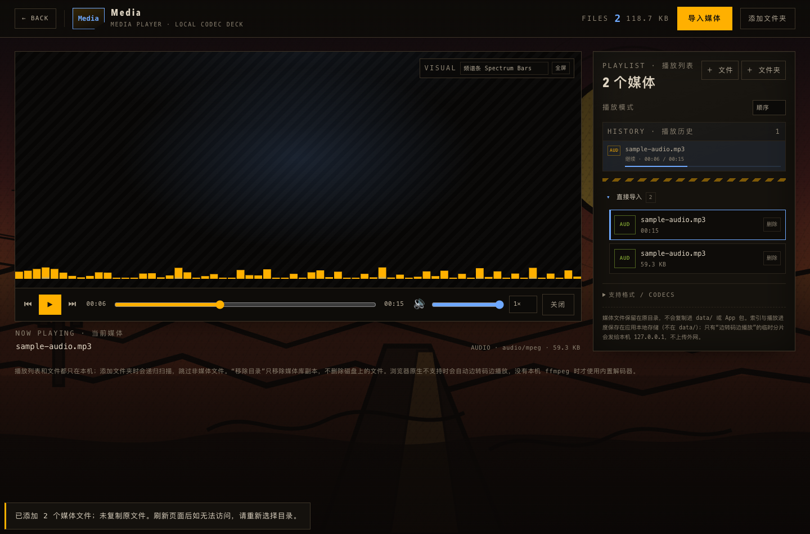

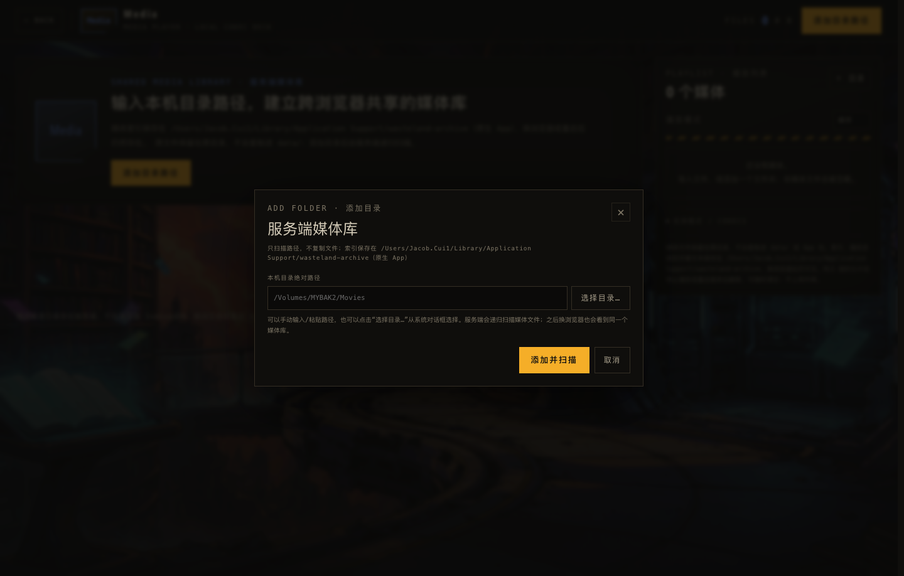

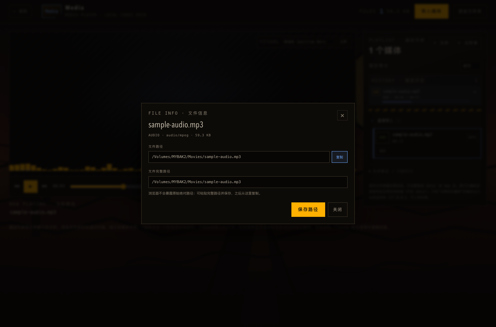

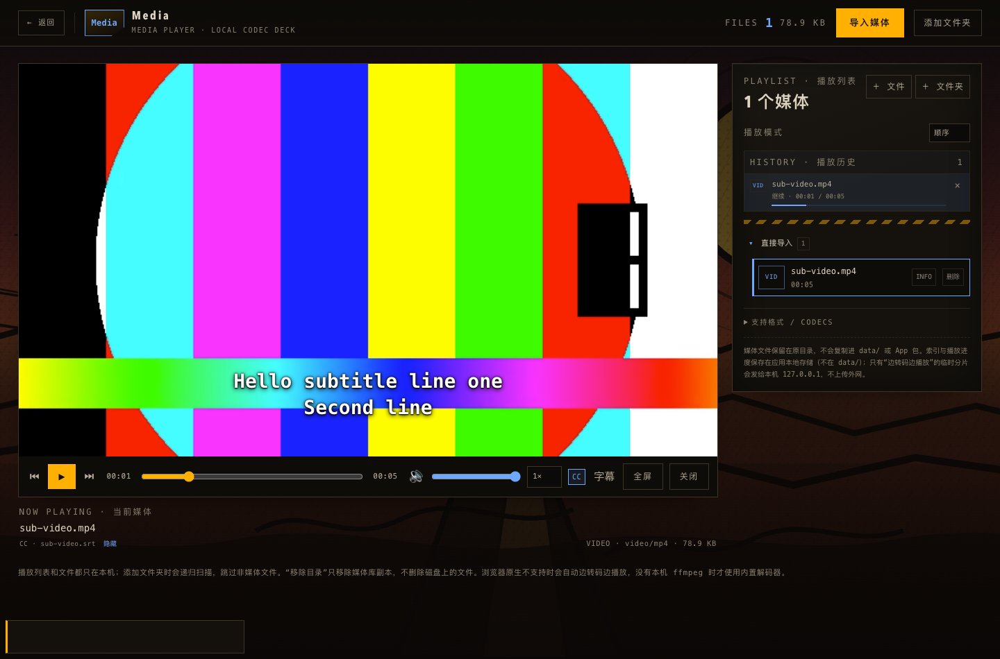

### Particle visualizer

The particle field reacts to the live low / mid / high frequency bands with a lightweight 110-particle renderer. **Full screen** hides all chrome; move the pointer to fade in file info, play state, progress, the exit button and the visual selector together.

Example: local audiobook chapter `book1_chapter01.mp3`.

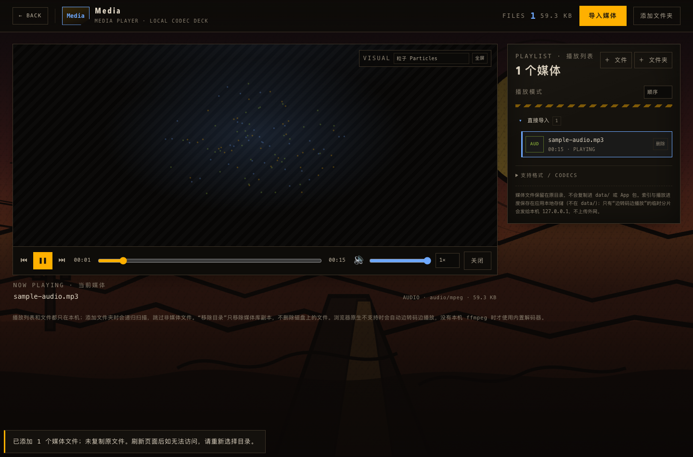
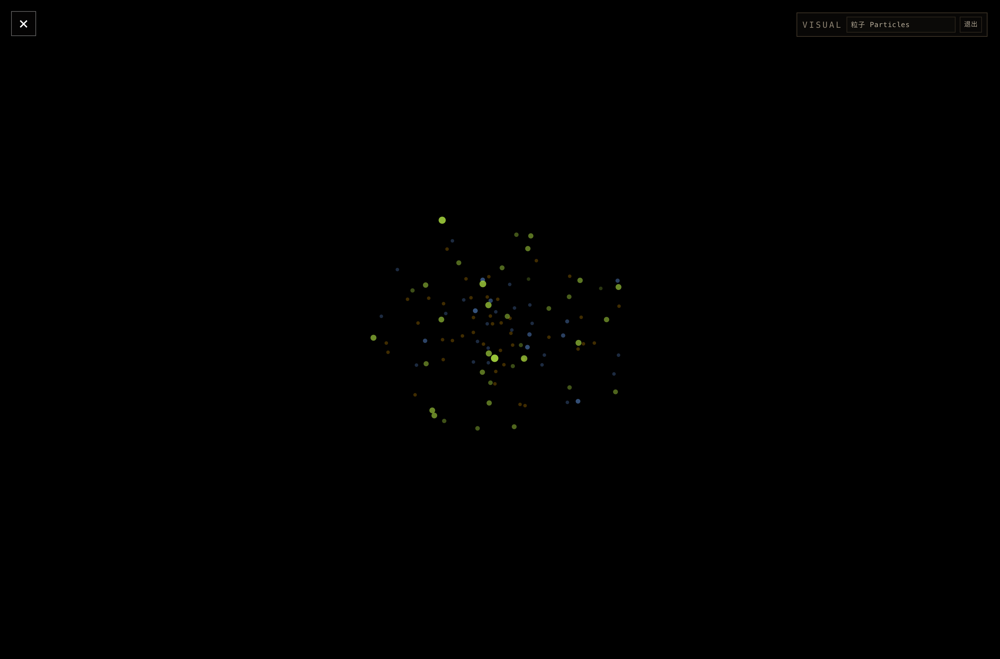

## Wasteland backgrounds

Backgrounds apply to the home page **and every plugin page**. Choose from eleven bundled illustrated backgrounds, upload your own, or select **No background image** to keep only the dark terminal backdrop:

- Wasteland Dunes
- Rust Highway
- Toxic Canyon
- Night Outpost
- Rust Pump
- Desert Relay
- Dome Mall
- Archive Vault
- Book Dome
- Night Rail
- Sky Library

Custom images are stored locally in:

```text
~/.wasteland_browser/bg_screens
```

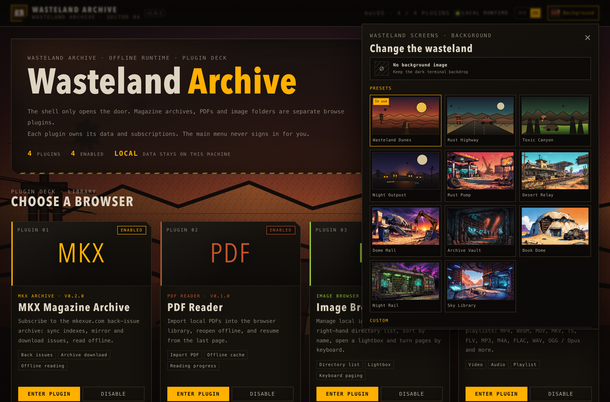
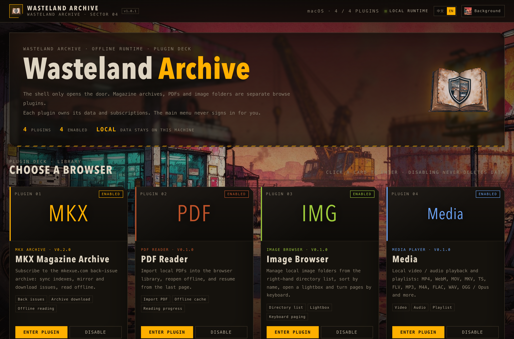

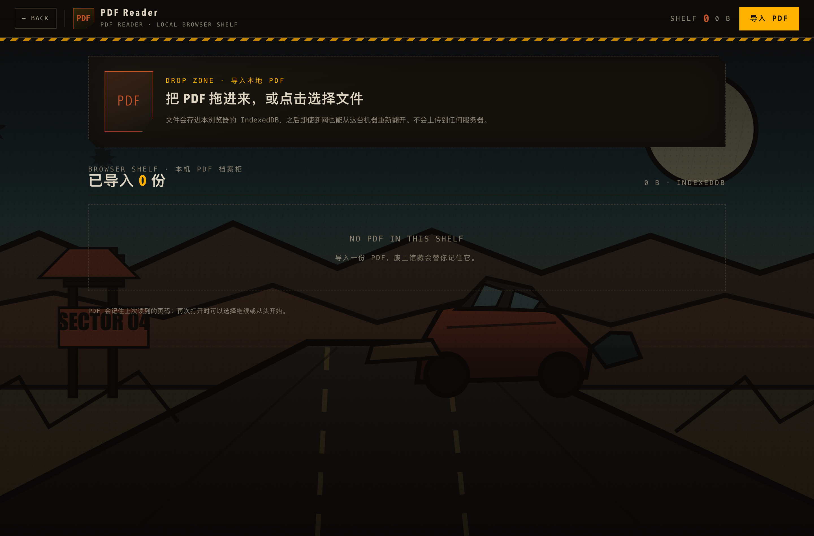
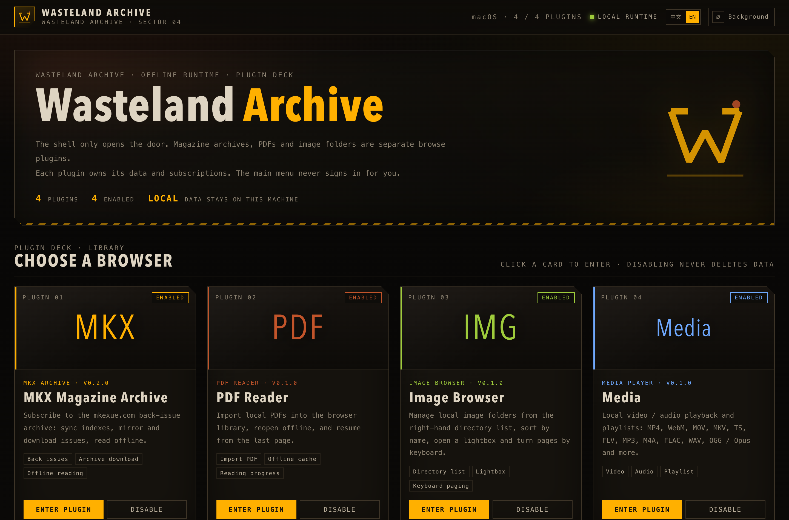

## Quick start — Web

Requirements: `make`, `curl` (or `wget`) and `tar`. Node, npm, ffmpeg and Chromium are installed automatically on first run.

```bash
make up
```

Open <http://127.0.0.1:5178>.

`make up` runs `scripts/bootstrap.sh`, which:

1. finds or downloads Node 22 (local `.runtime/node`, no sudo);
2. installs npm dependencies;
3. installs `ffmpeg-static`;
4. installs Playwright Chromium when no Chrome/Chromium is present;
5. builds `dist/` if missing;
6. starts the local Express server.

Useful commands:

| Command | Result |
| --- | --- |
| `make up` | Detect environment, install missing pieces, start the web server |
| `make bootstrap` | Environment check/install only |
| `make status` | Process + login status |
| `make down` | Stop the server |
| `make package` | Portable web package → `release/wasteland-archive-1.1.7.tar.gz` |
| `make app` | Native macOS apps (arm64 + Intel x64) → `.app` + zip + dmg |
| `make app-win` | Windows x64 portable app → `Wasteland-Archive-win-x64.zip` |

## Native macOS app

```bash
make app
```

Outputs (Apple Silicon + Intel):

```text
release/native/Wasteland-Archive-mac-arm64-1.1.7.dmg
release/native/Wasteland-Archive-mac-arm64-1.1.7.zip
release/native/Wasteland-Archive-mac-x64-1.1.7.dmg
release/native/Wasteland-Archive-mac-x64-1.1.7.zip
```

Both DMGs contain the app plus an **Applications shortcut**. Open the DMG and drag **废土馆藏.app** onto Applications. The app bundles Node, Chromium, `ffmpeg-static` and Playwright headless Chromium. It starts its own internal server on the stable port **5278** and stops it when the app quits.

- App data: `~/Library/Application Support/wasteland-archive`
- Custom backgrounds: `~/.wasteland_browser/bg_screens`
- The app is ad-hoc signed, not notarized. If Gatekeeper blocks a downloaded copy, right-click → Open, or run:
  `xattr -dr com.apple.quarantine "废土馆藏.app"`

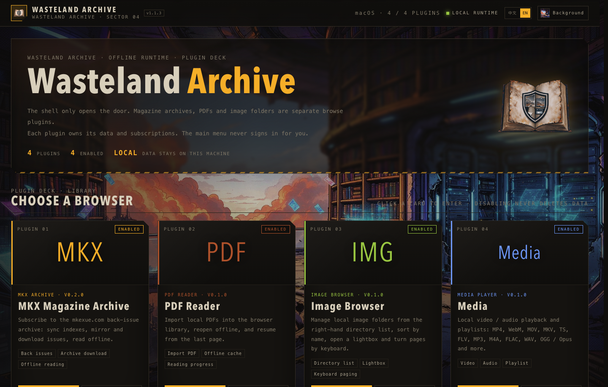

## Windows portable app

```bash
make app-win
```

Output:

```text
release/native/Wasteland-Archive-win-x64-1.1.7.zip
```

Unzip it on Windows 10/11 x64 and run **废土馆藏.exe**. This is a portable build — no installer, no Node installation. It bundles Windows Electron, ffmpeg and Playwright headless Chromium.

- Windows app data: `%APPDATA%\wasteland-archive`
- Custom backgrounds: `%USERPROFILE%\.wasteland_browser\bg_screens`
- The build is unsigned; Windows SmartScreen may show a warning on first run.

## Language packs

The UI chrome and plugin metadata are translated through `src/i18n/locales/en.js` and `zh.js`. Add another language by copying a locale file, importing it in `src/i18n/index.js`, and adding it to `localeOptions`.

The top bar language switch persists the choice in localStorage. A reload is optional, not required.

## Data locations

| What | Web | Native app |
| --- | --- | --- |
| Magazine archive | `data/issues` | `~/Library/Application Support/wasteland-archive/data/issues` |
| Auth token | `data/auth.json` | same under native app data |
| Media library index / positions / subtitles | `~/.wasteland_archive/media-index.json` | `~/Library/Application Support/wasteland-archive/media-index.json` |
| PDF/image libraries | IndexedDB `wasteland-browser` | same IndexedDB, app profile |
| Legacy 1.0.x media Blobs | purged automatically once at startup | same |
| Custom backgrounds | `~/.wasteland_browser/bg_screens` | shared with the same path |
| HLS transcode segments | server-library items: memory only, cleared on stop; legacy upload route: `~/.wasteland_archive/transcodes` | Application Support for legacy route |

**Upgrading from 1.0.x:** those versions copied every imported media file into IndexedDB as a Blob, which is what could grow to hundreds of GB in the app profile. 1.1.7 clears the legacy `media`, `mediaFolders` and `mediaTranscodes` stores once at startup; PDF and image-folder data are left untouched. The new server media index stores paths only.

On Windows the native archive is under:

```text
%APPDATA%\wasteland-archive\data\issues
```

The MKX **OPERATOR NOTES** panel shows the exact absolute path for the current machine, and the button next to it opens that directory in Explorer. Use **复制数据目录** to copy the full path.

To move magazines into the native app, quit the app, copy the contents of your web `data/issues` into the native `.../data/issues`, and reopen the app.

## Architecture

```text
Vue 3 + Vuetify + Vite
        │
        ├─ plugin deck / i18n / backgrounds
        │
        └─ local Express server
             ├─ MKX API + Playwright sync
             ├─ local archive files
             ├─ ffmpeg-static → HLS segments
             ├─ PDF.js vendor assets
             └─ background upload API

Electron (optional native shell)
  spawns the Express server with Electron's Node
  loads the same UI in a BrowserWindow
```

- PDF.js renders PDFs locally; worker and CMaps are served by the local server.
- Media source files stay in their original folders. The app stores the library index, playback positions and subtitles outside `data/`; server-library transcode segments are held in memory only. No media is copied into `data/` or IndexedDB.
- `~/.wasteland_browser/bg_screens` is the only shared user directory outside the app bundle.

## Browser support

- Current Chrome, Edge, Safari and Firefox.
- Tested with Chromium, Firefox and WebKit for home, MKX, PDF, images and media basics.
- Persistent image-folder handles use the File System Access API (Chromium). Safari/Firefox use a compatible folder picker and mark session folders as temporary.
- Media codecs depend on the browser; the support matrix reports native / maybe / needs transcode at runtime.

## Project layout

```text
electron/        Electron main process and native data migration
server/          Express API, archive store, HLS transcoding, backgrounds
src/             Vue 3 app, plugins, i18n, stores
bg_screens/      Bundled backgrounds + manifest
build/           App icon assets
scripts/         Bootstrap, native packaging helpers
docs/            Screenshots used by this README
langs/           Translated READMEs
```

## Privacy

- The main menu never asks for an account.
- MKX credentials stay in the browser; the server caches only a token.
- Local media and archives stay on this machine. The HLS transcoder listens only on `127.0.0.1`.
- `data/`, `.runtime/`, `node_modules/`, `release/` and native resources are ignored by git.

---

Repository: <https://github.com/jacobcui/wastland-archive>
