# 废土馆藏 · Wasteland Archive

<p align="center">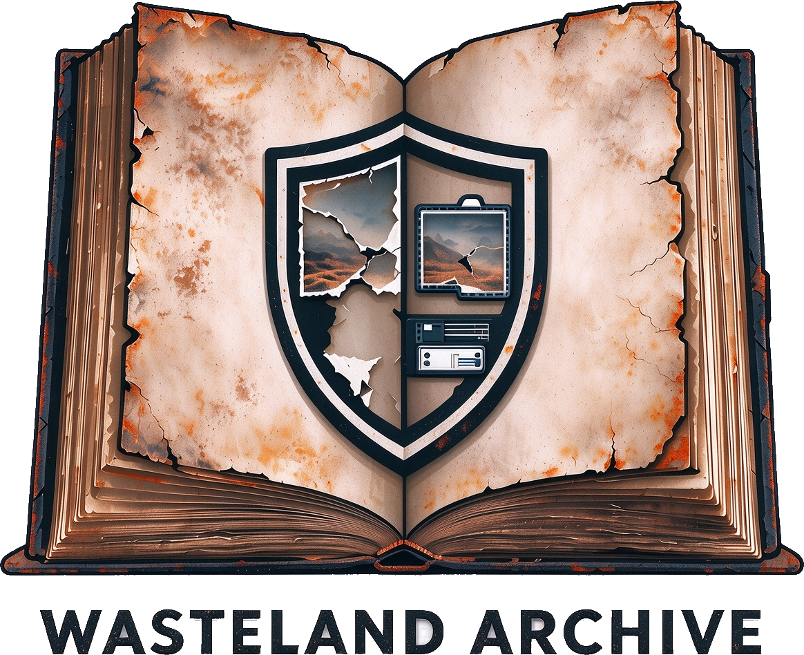</p>

**版本 1.1.3** · [更新日志](../CHANGELOG.md)

**废土馆藏** 是一个离线优先的本地阅读终端，用来管理杂志档案、PDF、图片文件夹与本地媒体。主程序只负责开门，所有馆藏都是插件，数据归插件自己管理。

[English](../README.md) | 简体中文

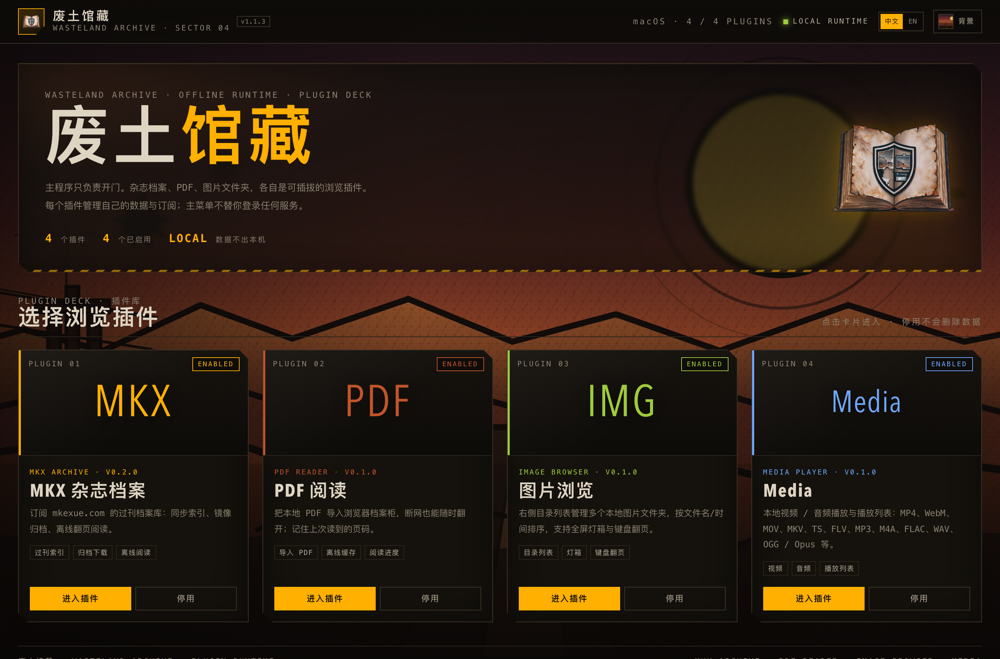

## 主要特性

- **离线优先**：归档、PDF、图片目录、媒体都保存在本机，不上传第三方云。
- **插件库**：MKX 杂志档案、PDF 阅读、图片浏览、Media 四个独立插件。停用插件不会删除数据。
- **原生桌面 App**：macOS（Apple Silicon + Intel）与 Windows x64 均为双击即用，内置 Node、Chromium、ffmpeg 与 Playwright，不再需要终端或单独 server。
- **可恢复转码**：原生不支持的视频由本机 ffmpeg 边转 HLS 边播放；切走保留后台会话与播放位置，切回继续。
- **废土背景**：内置 4 张原创废土风背景，也支持上传自定义图片到 ~/.wasteland_browser/bg_screens。
- **中英双语**：右上角切换 English / 中文；语言包在 src/i18n/locales。

## 插件

| 插件 | 功能 | 存储 |
| --- | --- | --- |
| **MKX 杂志档案** | 同步 mkexue.com 过刊索引、镜像归档、下载与离线阅读；支持翻页、缩放、平移、双页、胶片。 | 服务端 data/issues + 浏览器 IndexedDB 阅读进度 |
| **PDF 阅读** | 导入本地 PDF，断网重开，记住页码，继续或从头开始。 | IndexedDB wasteland-browser/pdfs |
| **图片浏览** | 管理多个本地图片目录，按文件名/时间排序，灯箱与键盘翻页。 | IndexedDB 目录句柄 / 会话目录 |
| **Media** | 本地视频音频、文件夹树播放列表、顺序/循环/单曲/随机、音频可视化、SRT/VTT 字幕、可恢复播放位置与 HLS 转码。源文件保留在原目录；媒体库索引在服务端，换浏览器仍然保留。 | `~/.wasteland_archive` / Application Support 中的服务端索引 + 本地 HLS 缓存 |

### MKX 档案

登录只在 MKX 插件内进行；主菜单不替你登录。密码只保存在浏览器，服务端仅缓存 token 到 data/auth.json（0600）。

归档下载是**串行**的：同一时间只执行一个归档任务，任务内部也一次只请求一页；后面的任务会排队，直到前一个任务完成。Sync 旁边的 **↻** 按钮会重新读取本地 data/issues 目录，适合手动拷贝归档后刷新。

### PDF 阅读

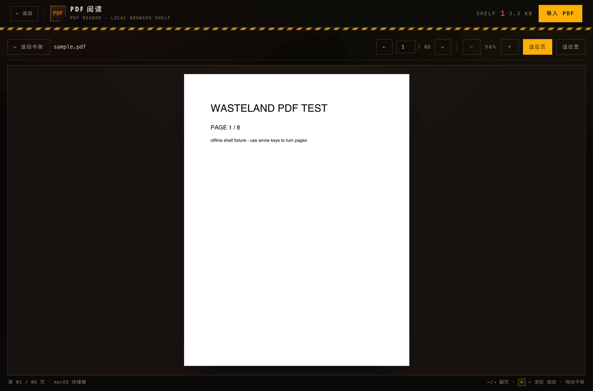

示例：[sample10.pdf](https://samplelib.com/pdf/sample10.pdf)（来自 samplelib.com）。

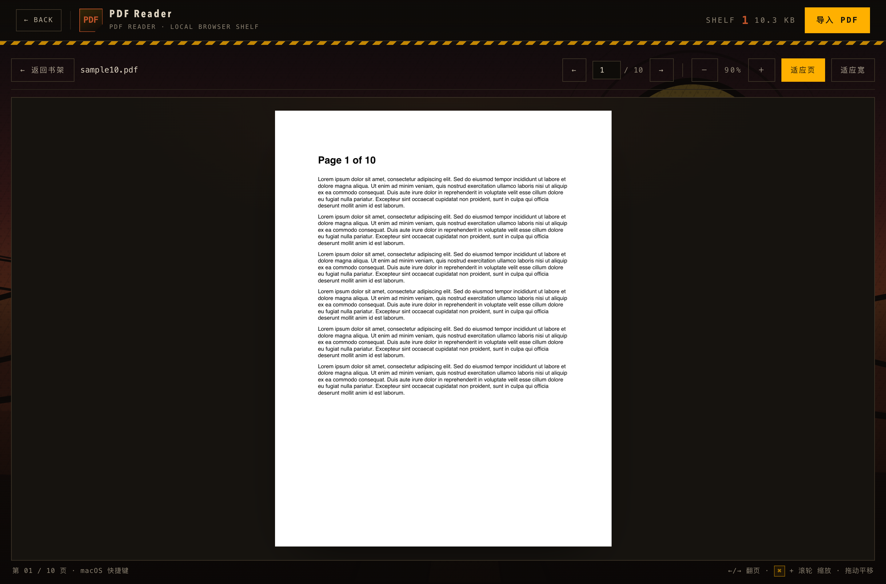

### 图片浏览

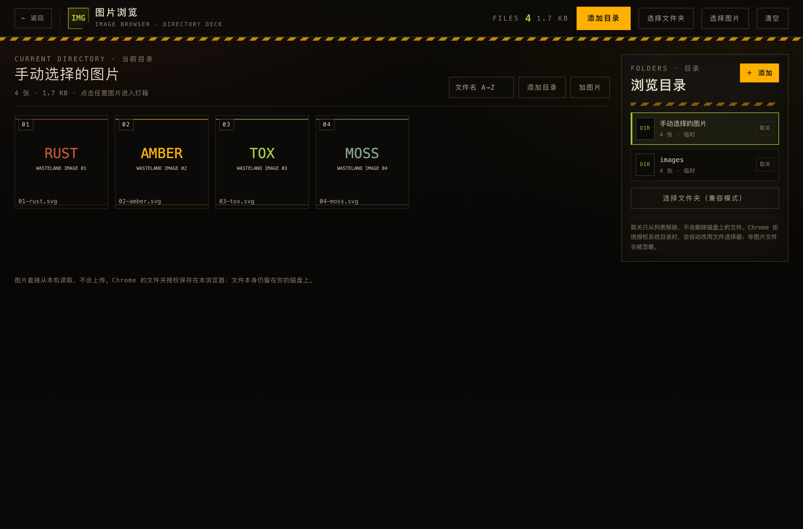

### Media

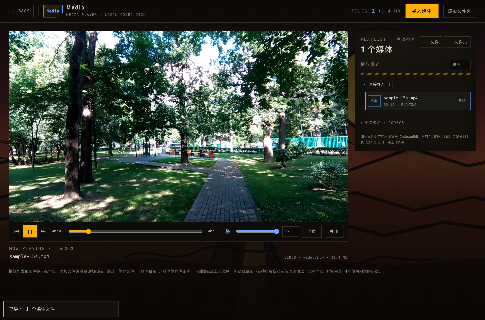

- **播放历史**：右侧列出最近播放的 8 个媒体及进度，点击即可从上次位置继续；已播完的从头开始。点击 × 只从历史移除，不删除文件。
- **每个文件独立记忆播放位置**：切换媒体、离开插件或重启 App 后，再次打开会从上次位置继续；已经播完的文件从开头开始。
- **文件信息**：INFO 按钮显示类型、大小和路径，并可复制；浏览器不暴露绝对路径时，可手动填写目录根路径或文件路径。
- **字幕**：文件夹视频会自动加载同名 `.srt` / `.vtt`；也可以手动选择字幕，用 CC 开关，全屏时同样显示。
- **服务端媒体库**：只需添加一次绝对目录路径，服务端扫描后把索引、播放位置和字幕保存在 `~/.wasteland_archive`（原生 App 为 Application Support）。换浏览器后仍是同一个媒体库。
- **不复制源文件**：媒体保留在原目录，不复制进 data/ 或 IndexedDB。
- 优先使用浏览器原生解码。大体积 H.264/AAC MP4 直接原生播放；只有浏览器不支持的格式才走本机转码。
- 原生失败时自动由本机 ffmpeg 生成 2 秒 HLS 片段，首段生成即播放。
- 切到别的媒体再切回来：复用 HLS 会话与已生成片段，并从上次播放位置继续。
- 音频可视化：波形、频谱条、线状频谱、径向频谱、粒子、山峦。
- 全屏音频会自动隐藏所有控制条；移动鼠标会同时淡入文件信息、进度、退出和可视化选择。
- 没有可用 ffmpeg 时，小文件自动退回 WASM 完整转码。

示例：[sample-15s.mp4](https://samplelib.com/mp4/sample-15s.mp4)（来自 samplelib.com）。

> **1.1.3 升级说明。** 媒体库索引已从浏览器 IndexedDB 移到服务端。旧浏览器条目无法自动迁移，因为浏览器不会暴露绝对路径。请点击一次 **添加目录路径**，粘贴媒体根目录（例如 `/Volumes/MYBAK2/Movies`）；服务端扫描后，所有浏览器共用同一份媒体库。

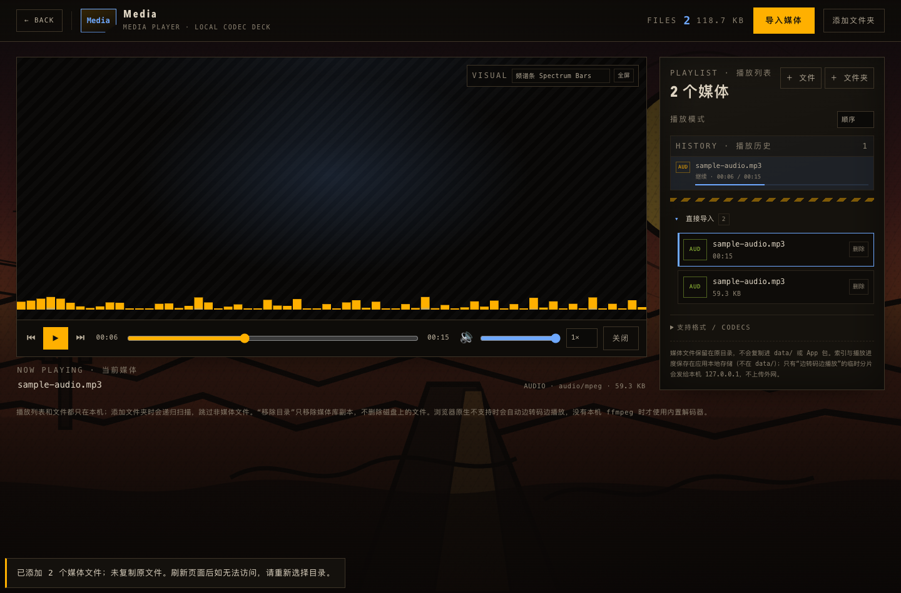

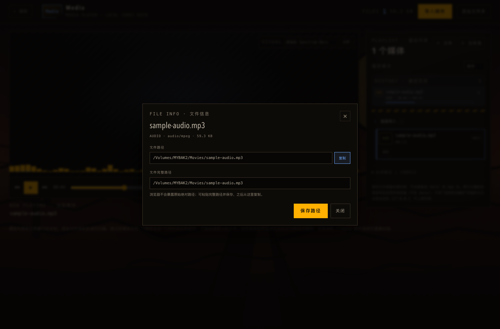

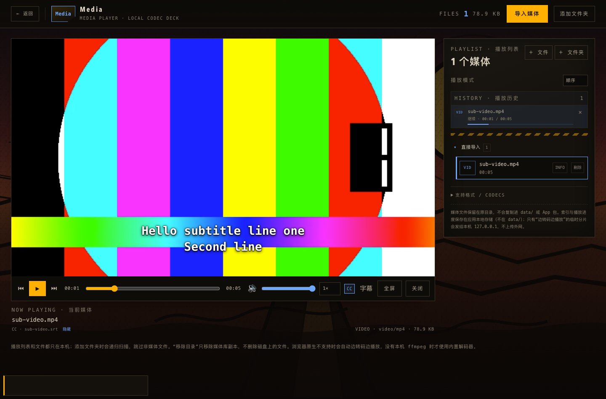

### 粒子可视化

粒子会随实时低 / 中 / 高频段爆开、流动，使用轻量的 110 粒子渲染。**全屏** 后会隐藏所有控制；移动鼠标时会同时淡入文件信息、播放状态、进度、退出按钮和可视化选择。

示例：本地有声书章节 book1_chapter01.mp3。

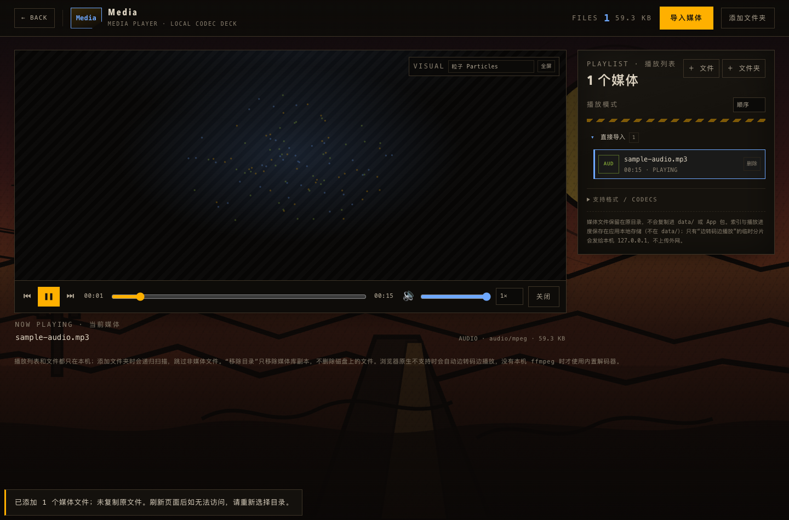
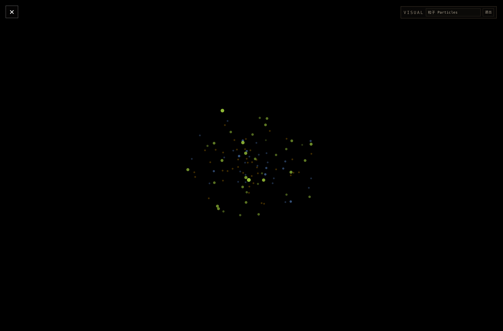

## 废土背景

背景会同时应用到首页**和所有插件内页**。内置 11 张插画背景，也可上传自定义图片，或选择 **无背景图片** 只保留深色终端底色：

- 废土沙丘
- 锈色公路
- 毒沼峡谷
- 夜行哨站
- 锈色加油站
- 荒漠中继站
- 穹顶商场
- 档案地库
- 书穹
- 夜行列车
- 天空图书馆

自定义图片保存到：

~~~text
~/.wasteland_browser/bg_screens
~~~

点击右上角「背景」即可选择、上传、删除、恢复默认。

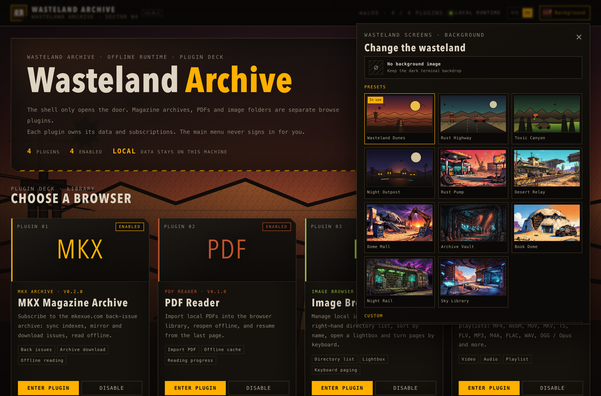
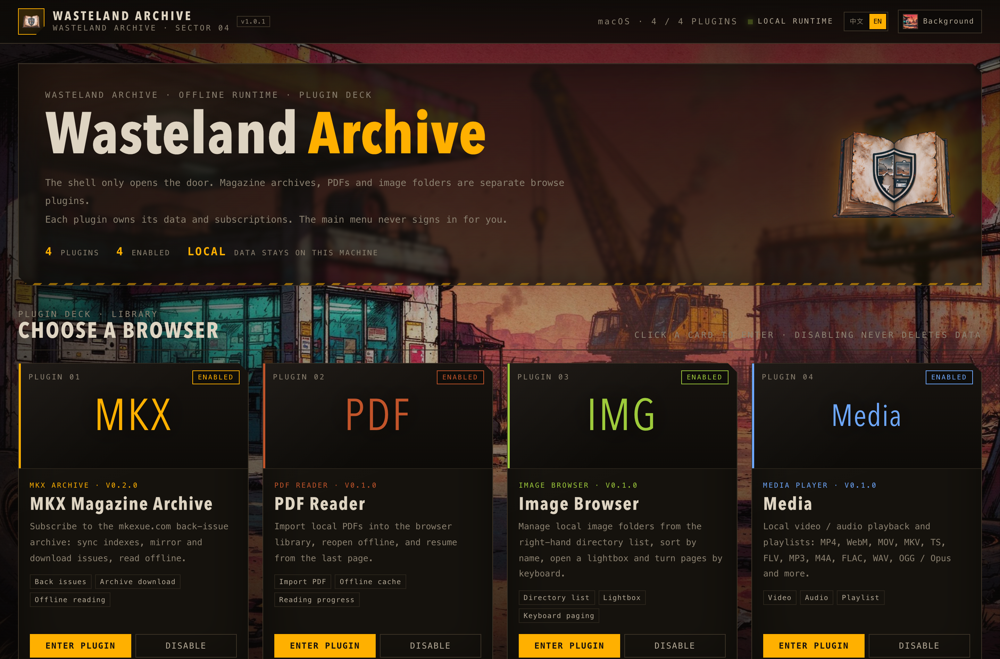

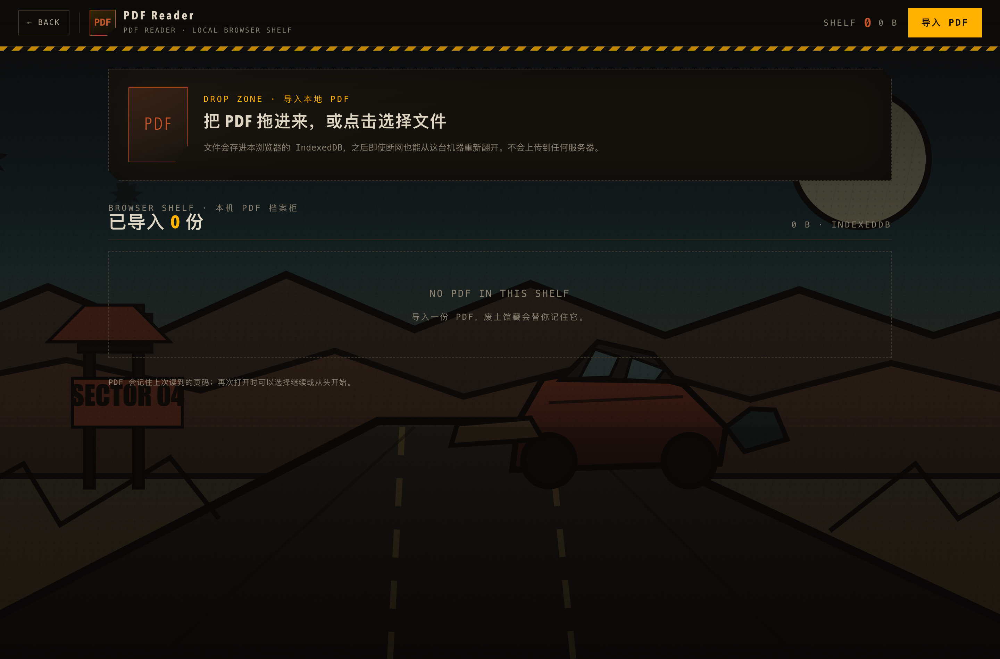
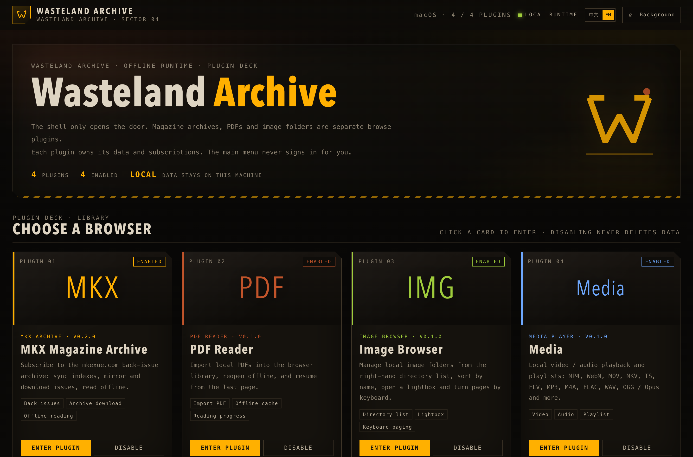

## Web 快速开始

只需要 make、curl（或 wget）、tar。Node、npm、ffmpeg、Chromium 由首次启动自动准备。

~~~bash
make up
~~~

打开 <http://127.0.0.1:5178>。

make up 会运行 scripts/bootstrap.sh：

1. 检测/下载 Node 22（本地 .runtime/node，不需要 sudo）
2. 安装 npm 依赖
3. 安装 ffmpeg-static
4. 没有 Chrome 时安装 Playwright Chromium
5. 没有 dist/ 时构建前端
6. 启动本地 Express 服务

常用命令：

| 命令 | 说明 |
| --- | --- |
| make up | 检测环境、安装缺失项、启动 Web 服务 |
| make bootstrap | 只检测/安装环境 |
| make status | 查看进程 + 登录状态 |
| make down | 停止服务 |
| make package | 生成 Web 便携包 release/wasteland-archive-1.1.3.tar.gz |
| make app | 生成 macOS 原生 App（arm64 + Intel x64）+ zip + dmg |
| make app-win | 生成 Windows x64 便携包 Wasteland-Archive-win-x64.zip |

## 原生 macOS App

~~~bash
make app
~~~

输出（Apple Silicon + Intel）：

~~~text
release/native/Wasteland-Archive-mac-arm64-1.1.3.dmg
release/native/Wasteland-Archive-mac-arm64-1.1.3.zip
release/native/Wasteland-Archive-mac-x64-1.1.3.dmg
release/native/Wasteland-Archive-mac-x64-1.1.3.zip
~~~

两个 DMG 都包含 App 和 **Applications 快捷方式**。打开 DMG，把 **废土馆藏.app** 拖到 Applications 上。App 内置 Node、Chromium、ffmpeg-static 和 Playwright headless Chromium，使用固定的内部端口 **5278**，退出时自动停止服务。

- App 数据：~/Library/Application Support/wasteland-archive
- 自定义背景：~/.wasteland_browser/bg_screens
- 未做 Apple notarization；从网络下载后被 Gatekeeper 拦截时，右键 → 打开，或执行：
  xattr -dr com.apple.quarantine "废土馆藏.app"

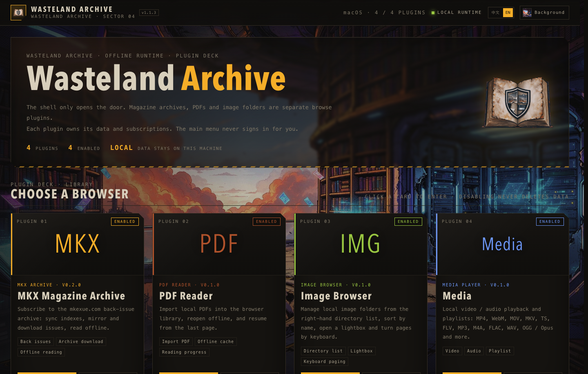

## Windows 便携版

~~~bash
make app-win
~~~

输出：

~~~text
release/native/Wasteland-Archive-win-x64-1.1.3.zip
~~~

在 Windows 10/11 x64 上解压，运行 **废土馆藏.exe** 即可。这是便携版，不需要安装 Node，也不需要单独启动 server；包内包含 Windows Electron、ffmpeg 和 Playwright headless Chromium。

- Windows App 数据：%APPDATA%\wasteland-archive
- 自定义背景：%USERPROFILE%\.wasteland_browser\bg_screens
- 构建未签名；首次运行 Windows SmartScreen 可能提示。

## 语言包

界面框架与插件元数据在：

~~~text
src/i18n/locales/en.js
src/i18n/locales/zh.js
~~~

新增语言：复制一份 locale，在 src/i18n/index.js 导入，并加入 localeOptions。右上角切换会保存到 localStorage，不强制重启。

## 数据目录

| 内容 | Web | 原生 App |
| --- | --- | --- |
| 杂志归档 | data/issues | ~/Library/Application Support/wasteland-archive/data/issues |
| 登录 token | data/auth.json | 原生 App data 下的 auth.json |
| 媒体库索引 / 播放位置 / 字幕 | `~/.wasteland_archive/media-index.json` | `~/Library/Application Support/wasteland-archive/media-index.json` |
| PDF / 图片库 | IndexedDB wasteland-browser | 原生 App profile 内的同源 IndexedDB |
| 1.0.x 旧媒体 Blob | 启动时自动清除一次 | 同上 |
| 自定义背景 | ~/.wasteland_browser/bg_screens | 同一路径，互通 |
| HLS 临时文件 | `~/.wasteland_archive/transcodes`（1 小时 TTL） | Application Support `transcodes` |

**从 1.0.x 升级：**旧版本把每个导入的媒体文件作为 Blob 复制进 IndexedDB，所以 App profile 可能膨胀到数百 GB。1.1.3 启动时会清除一次旧的 `media`、`mediaFolders`、`mediaTranscodes` 存储；PDF / 图片库不受影响。新的服务端媒体索引只保存路径。

Windows 原生版的归档目录：

```text
%APPDATA%\wasteland-archive\data\issues
```

MKX 的 **OPERATOR NOTES** 会显示当前机器的完整绝对路径，旁边的按钮会在资源管理器中打开该目录；**复制数据目录** 可复制完整路径。

把 Web 的杂志搬到原生 App：退出 App，把 Web data/issues 的内容复制到原生 .../data/issues，再重新打开。

## 架构

~~~text
Vue 3 + Vuetify + Vite
        │
        ├─ 插件库 / i18n / 背景
        │
        └─ 本地 Express 服务
             ├─ MKX API + Playwright 同步
             ├─ 本地归档文件
             ├─ ffmpeg-static → HLS 切片
             ├─ PDF.js 资源
             └─ 背景上传 API

Electron（可选原生壳）
  用 Electron 自带 Node 启动 Express
  BrowserWindow 加载同一套 UI
~~~

- PDF.js 本地渲染，worker 与 CMaps 由本地服务提供。
- 媒体源文件保留在原目录。媒体库索引、播放位置和字幕保存在 data/ 之外；另有临时 HLS 缓存。不复制媒体进 data/ 或 IndexedDB。
- ~/.wasteland_browser/bg_screens 是 App 包外唯一共享的用户目录。

## 浏览器兼容

- 当前 Chrome、Edge、Safari、Firefox。
- 已用 Chromium、Firefox、WebKit 测试首页、MKX、PDF、图片和媒体基础流程。
- 图片目录持久句柄依赖 File System Access API（Chromium）；Safari/Firefox 使用兼容目录选择，标记为「临时」。
- 媒体编码支持取决于浏览器；右侧支持矩阵会显示原生 / 可尝试 / 需转码。

## 隐私

- 主菜单不询问账号。
- MKX 密码只在本机浏览器；服务端只保存 token。
- 本地媒体和归档不出本机；HLS 转码服务只监听 127.0.0.1。
- data/、.runtime/、node_modules/、release/、native resources 都被 git 忽略。

---

仓库：<https://github.com/jacobcui/wastland-archive>
